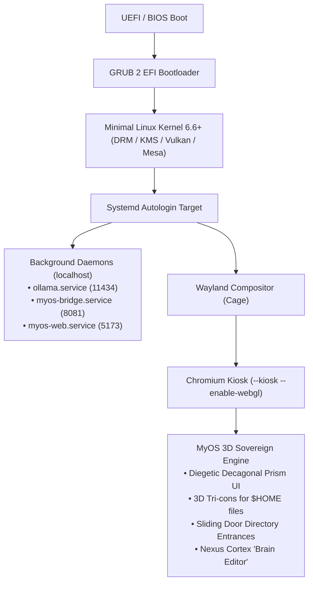

# MyOS Sovereign Live OS: USB Bootable 3D Kiosk & Bare-Metal Installer

## 1. Vision & Architecture Overview
**MyOS Sovereign Live OS** transforms MyOS from a web application into an independent, bare-metal operating system. When booted from a USB flash drive or installed directly to a hard drive's boot sector, the machine powers up straight into a full-screen, hardware-accelerated 3D environment without traditional OS desktop clutter.

---

## 2. The 4 Native Pillars of the Distro

### A. The Diegetic Prism as the Primary Shell
- Replaces standard 2D taskbars, docks, and window manager tiling.
- A 10-faced widescreen (16:9) decagonal prism stands in 3D around the observer.
- Turning left/right or orbiting rotates through the 10 sovereign realms (Filesystem, Code IDE, Sprite Lab, Soundstage, Terminal, BBS Network, etc.).

### B. 3D "Tri-cons" & Sliding Door Entrances
- **Tri-cons**: Instead of flat icons, files in `$HOME` (`Documents`, `Projects`, `Media`) manifest as extruded, hovering triangular prisms with glowing runic glyphs:
  - Code files (`.ts`, `.py`, `.rs`, `.sh`): Cyan `∴`
  - Documents & Notes (`.md`, `.txt`, `.pdf`): Amber `✧`
  - Audio & Visual Media (`.png`, `.blend`, `.mp4`): Pink `∿`
  - Configuration (`.json`, `.toml`, `.env`): Emerald `⚙️`
- **Sliding Door Entrances**: Folders in `$HOME` are 3D cybernetic doorway frames. As the player walks toward a folder (within 3.5m), the motorized doors smoothly part open with a glowing portal beam. Walking through or clicking enters that directory.

### C. The Rubik's Cortex Cube as the "Brain Editor"
- The 3D Rubik's Cube (`NexusCube.tsx`) acts as the system settings console and cognitive brain editor:
  - **Model Endpoint**: Toggle between local Ollama `gemma4:26b` and remote Gemini fallback.
  - **Cognitive Decay**: Biological memory decay curves and auto-reflection interval.
  - **Pillar Tuning**: Slider controls for the 10 Topological Anchors.
  - **Hardware**: Display resolution, CRT scanlines, and audio output.

### D. Bare-Metal Installer (`myos-install.sh`)
- Booting from the USB brings up the Live image.
- A single command (`sudo myos-install`) or diegetic action in 3D launches the curses-based partition installer:
  - Select target NVMe / SSD (`/dev/nvme0n1` or `/dev/sda`).
  - Sets up EFI System Partition (`ESP`) + Ext4 root (`/`).
  - Rsyncs the live rootfs, installs GRUB 2 EFI bootloader, and configures autologin.
  - Power cycle the machine, unplug the USB, and the machine boots directly into MyOS as its native operating system.

---

## 3. Directory Layout
- `build_live_iso.sh`: Automated Debian `live-build` / ISO generator script.
- `myos-kiosk-session.sh`: Wayland Cage + Chromium hardware-accelerated kiosk launcher.
- `myos-bridge-service.js`: Filesystem bridge daemon syncing host `/home/myos` into 3D Tri-cons.
- `myos-install.sh`: Interactive hard drive installation wizard.
